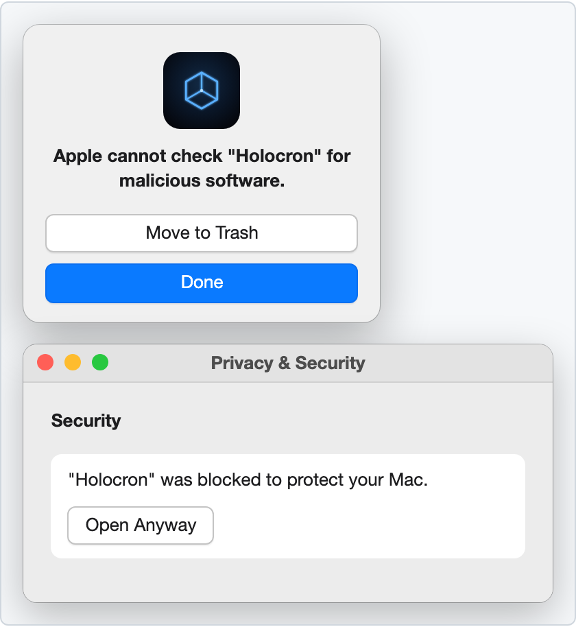
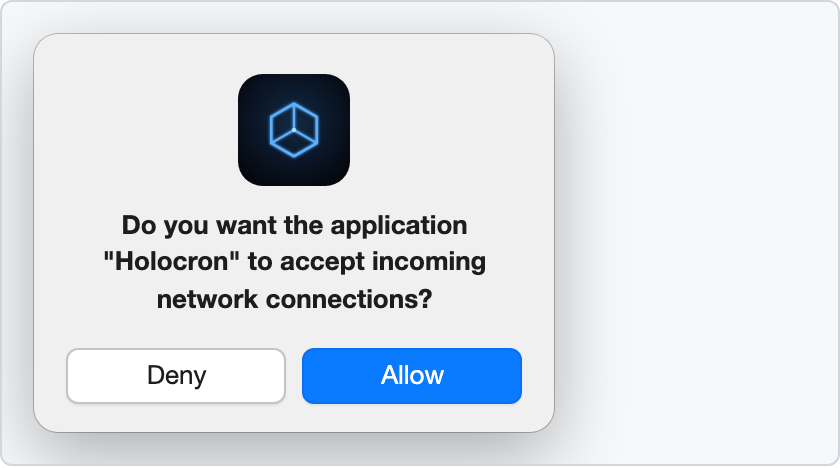
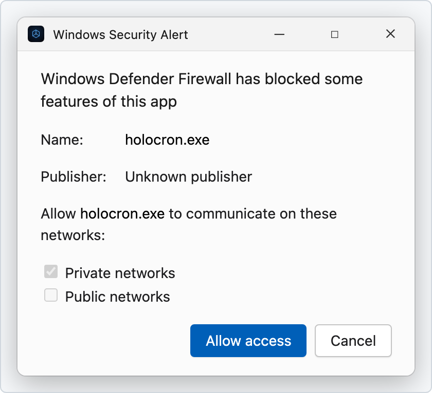

# Run Holocron on your computer

This is your own Holocron, on your computer. Phones and laptops on your Wi-Fi can open it and join your table. No internet is needed at the table.

This download comes without the rulebooks' words. If you have a dataset of your own, such as an OggDude data folder, open ⚙ in Holocron and choose **Fill in rule text…** to fill them in on your computer.

## Mac

**1. Download Holocron for your computer.**

- Mac: `Holocron-<version>-mac-apple-silicon.zip`
- Windows: `Holocron-<version>-windows.zip`

**2. Open it. The first time, your computer warns you.**

Your Mac says it can't check Holocron. Click Done, open System Settings, then Privacy & Security, and click Open Anyway. Type your Mac's password, then click Open.

**3. Open Holocron.** It's in the Holocron folder you unzipped. A small Holocron window opens, and your browser opens your own Holocron.

**4. The first time, allow connections.**

If your Mac asks whether Holocron can accept incoming connections, click Allow.

This lets phones on your Wi-Fi reach Holocron.

**5. Players open the address in the Holocron window** on a phone or laptop on the same Wi-Fi, or scan the code when you open a table.

**To stop Holocron,** close its window.

## Windows

**1. Download Holocron for your computer.**

- Mac: `Holocron-<version>-mac-apple-silicon.zip`
- Windows: `Holocron-<version>-windows.zip`

**2. Open it. The first time, your computer warns you.**

Windows says it protected your PC. Click More info, then Run anyway.

If Windows says Smart App Control blocked Holocron, this download can't run on that PC.

**3. Open Holocron.** It's in the Holocron folder you unzipped. A small Holocron window opens, and your browser opens your own Holocron.

**4. The first time, allow connections.**

Windows asks whether holocron.exe can use your network. Tick Private networks, then click Allow access.

This lets phones on your Wi-Fi reach Holocron.

**5. Players open the address in the Holocron window** on a phone or laptop on the same Wi-Fi, or scan the code when you open a table.

**To stop Holocron,** close its window.

## Keep your characters

Characters are saved in the browser that made them, at the address it used. On this computer that address never changes.

Players' phones use this computer's Wi-Fi address, and your router can change it. If a player's characters seem gone, that's why. They're not deleted.

- **Stop it happening:** in your router's settings, reserve this computer's address. It's often called a "DHCP reservation".
- **Move them across:** on the old address, open ⚙ and **Back up everything…**, then **Save backup file**. On the new address, open **Back up everything…** and **Restore from a file**.
